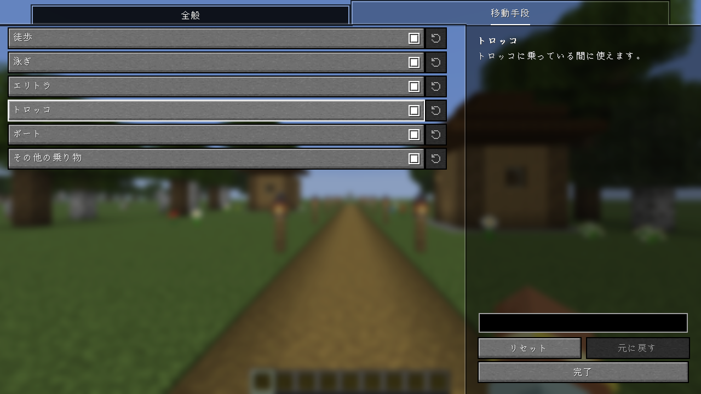

# Freelook Plus

[English](README.md) | 日本語

向いている方向を変えずに、カメラだけを回して周りを見渡せる Fabric 向けクライアント MOD です。
クライアントに入れるだけで動作し、バニラサーバーでも使えます（サーバー側への導入は不要です）。

乗り物に乗っているときや、エリトラで飛んでいるときにも使えます。

## 設定

キーは初期状態では割り当てられていません。操作設定の「Freelook Plus」で割り当ててください。
設定画面で、キーを押している間だけ使うか、押すたびに切り替えるかを選べます。
また、どの移動手段（徒歩・泳ぎ・エリトラ・トロッコ・ボート・その他の乗り物）のときに使えるかも選べます。
設定画面は [Mod Menu](https://modrinth.com/mod/modmenu) から開きます。

## 注意

サーバーによっては、ルールで Freelook が禁止されていることがあります。
使用はサーバーのルールに従ってください。
