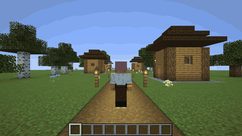
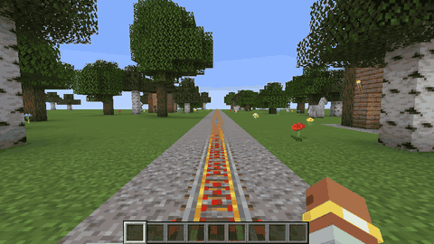
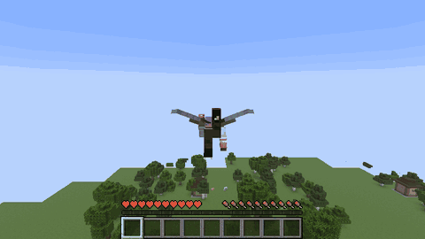
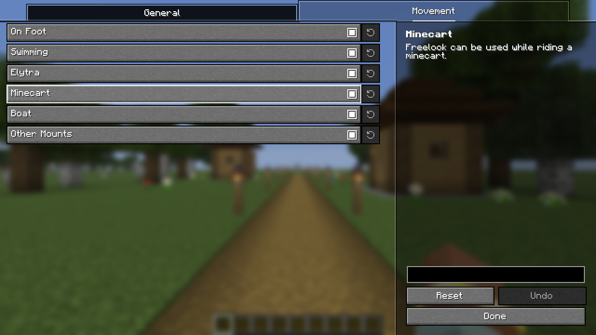

# Freelook Plus

English | [日本語](README.ja.md)

A client-side Fabric mod that lets you look around by turning only the camera, without changing the direction you face.
Just install it on your client; it also works on vanilla servers (nothing needs to be installed on the server).

It works while riding and flying too.

## Settings

The key is unbound by default; assign it under Controls → Freelook Plus.
In the settings screen, you can choose whether the key works while held or toggles on each press.
You can also choose for which kinds of movement Freelook can be used: on foot, swimming, elytra, minecart, boat and other mounts.
The settings screen is opened from [Mod Menu](https://modrinth.com/mod/modmenu).

## Note

Some servers prohibit freelook in their rules.
Follow the rules of the server you play on.
